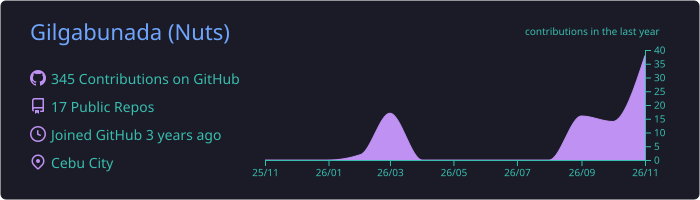
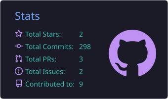
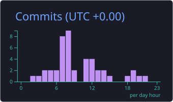
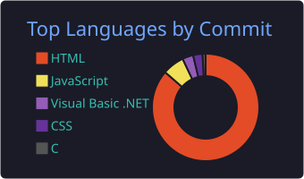
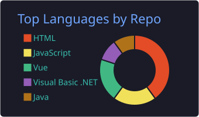

<!-- ═══════════════ HEADER ═══════════════ -->
<div align="center">


<a href="https://github.com/Gilgabunada">
  
</a>

<br/>

<a href="https://gil.guelbertgabunada.workers.dev/"></a>
<a href="https://gilgabunada.github.io/Programming-Odyssey/"></a>


</div>

<br/>

<!-- ═══════════════ ABOUT ═══════════════ -->
## ⚡ About Me

<table>
<tr>
<td width="62%" valign="top">

```yaml
name:      Gil Gabunada
role:      Full Stack Web Dev + AI Enthusiast
degree:    BS Computer Engineering 🎓
focus:     AI · IoT · Embedded · Web Apps
mode:      Building. Breaking. Learning.
open_to:   Collaborating on groundbreaking tech
```

</td>
<td width="38%" valign="top">

💡 Passionate about **innovative solutions** and complex coding challenges

🔌 If it has **circuits**, I'm in

🤝 Always up for a **collab** on cool projects

</td>
</tr>
</table>

<br/>

<!-- ═══════════════ TECH STACK ═══════════════ -->
## 🧰 Tech Stack

<div align="center">

**💻 Languages**


**🧩 Frameworks & Libraries**


**🛠️ Tools & Platforms**


**🤖 AI & Data Science**

     

</div>

<br/>

<!-- ═══════════════ PROJECTS ═══════════════ -->
## 🚀 Projects

<table>
<tr>
<td width="50%" valign="top">

### 🛒 Tech Store Backend
A REST API backend for a tech store, fully documented and testable in Postman.


<a href="https://documenter.getpostman.com/view/58149914/2sBYHXPxns"></a>

</td>
<td width="50%" valign="top">

### 📚 Programming Odyssey
My learning journey and coding experiments, all in one place.


<a href="https://gilgabunada.github.io/Programming-Odyssey/"></a>

</td>
</tr>
</table>

<br/>

<!-- ═══════════════ FUN FACTS ═══════════════ -->
## 🎮 Fun Facts

> 🍫 Built a **smart fridge** that alerts me when I'm out of snacks — *my greatest achievement*
>
> 🐱 Tried teaching my cat to code… she can now type `meow` at **lightning speed**
>
> 🔌 Hardware projects are my **happy place**

<br/>

<!-- ═══════════════ STATS ═══════════════ -->
## 📊 GitHub Stats

<div align="center">


<br/><br/>


<br/><br/>









</div>

<br/>

<!-- ═══════════════ CONNECT ═══════════════ -->
## 📬 Let's Connect

<div align="center">

<a href="mailto:guelbertgabunada@gmail.com"></a>
<a href="https://x.com/GGabunada49596"></a>
<a href="https://www.facebook.com/gil.gabunada/"></a>

<br/><br/>

<i>✨ Building the future, one line of code at a time ✨</i>


</div>
